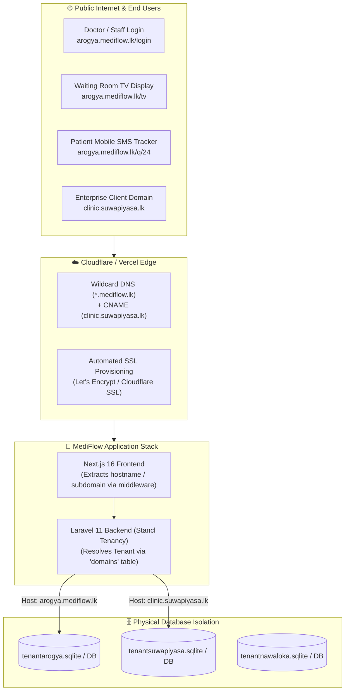
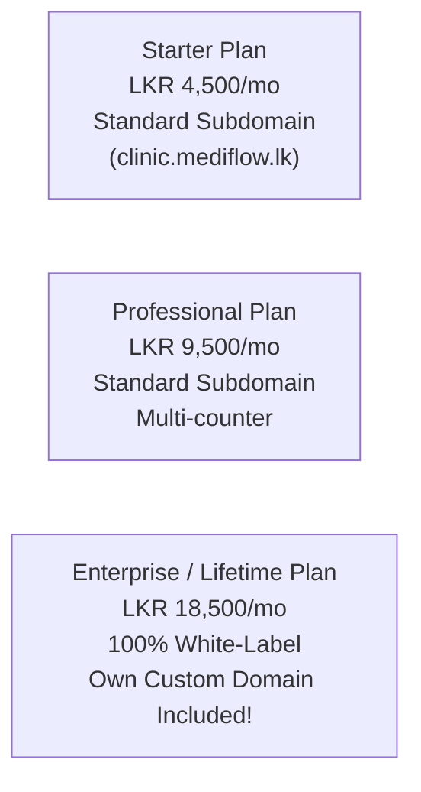

# 🌐 MediFlow — Subdomain & Custom Domain Configuration Guide
> **Multi-Tenant Clinical SaaS Domain Mapping, Wildcard DNS & Enterprise Custom Domains**  
> *Target Audience: Platform Owner (SuperAdmin), DevOps, and Clinic Clients*

---

## 📑 පටුන (Table of Contents)
1. [Overview & Architecture (හැඳින්වීම)](#1-overview--architecture)
2. [Domain Strategy: Subdomains vs. Custom Domains](#2-domain-strategy)
3. [Platform Wildcard DNS Setup (මූලික Platform DNS සැකසුම)](#3-platform-wildcard-dns-setup)
4. [Client Custom Domain Setup: Step-by-Step (Client ගේ Domain එකක් සම්බන්ධ කරන හැටි)](#4-client-custom-domain-setup-step-by-step)
5. [Automated SSL (HTTPS) Provisioning (නොමිලේ SSL ආරක්ෂාව)](#5-automated-ssl-https-provisioning)
6. [Platform Owner Workflow in SuperAdmin Dashboard](#6-platform-owner-workflow-in-superadmin-dashboard)
7. [Code Implementation & Request Lifecycle (Next.js & Laravel Tenancy)](#7-code-implementation--request-lifecycle)
8. [Troubleshooting & Verification (ගැටළු නිරාකරණය)](#8-troubleshooting--verification)
9. [Enterprise Pricing & Monetization Model (ආදායම් ආකෘතිය)](#9-enterprise-pricing--monetization-model)

---

## 1. Overview & Architecture

MediFlow යනු **Multi-Tenant Architecture** එකක් මත පදනම් වූ සායන කළමනාකරණ පද්ධතියකි (Clinical Management System). සෑම ක්ලිනික් එකකටම වෙනම Isolated Database එකක් පවතින අතර, පරිශීලකයින් (Doctors, Receptionists, Cashiers, Patients) පද්ධතියට ප්‍රවේශ වන්නේ ඔවුන්ගේම සුවිශේෂී URL එකක් හරහාය.



---

## 2. Domain Strategy

MediFlow සතුව domain strategies දෙකක් පවතී:

| Feature | Standard Subdomain | Enterprise Custom Domain |
| :--- | :--- | :--- |
| **URL Example** | `arogya.mediflow.lk` | `clinic.suwapiyasa.lk` හෝ `arogyaclinic.com` |
| **Target Clients** | Standard Clinics, GPs, Dispensaries | Hospitals, Large Medical Centres, Branded Chains |
| **Setup Time** | **ක්ෂණිකයි (Instant ~ 0 seconds)** | 5-15 මිනිත්තු (DNS CNAME propagation) |
| **Client DNS Action** | කිසිවක් අවශ්‍ය නැත | 1 CNAME record add කිරීම අවශ්‍යයි |
| **Branding** | Co-branded (Clinic + MediFlow) | 100% White-labeled (Client's Brand Only) |
| **Tier** | Included in Starter & Professional | Enterprise / Premium Add-on |

---

## 3. Platform Wildcard DNS Setup (මූලික Platform DNS සැකසුම)

Platform Owner විසින් තම master domain එක සඳහා එක් වරක් පමණක් **Wildcard DNS** සකස් කළ යුතුය. මෙය සිදු කළ පසු, නව ක්ලිනික් 1,000ක් එකතු කළද ඒ කිසිවක් සඳහා අලුතෙන් DNS හැදීමට අවශ්‍ය නොවේ.

### Cloudflare / Namecheap / GoDaddy DNS Settings:

| Type | Name / Host | Target / Value | Proxy Status | Description |
| :--- | :--- | :--- | :--- | :--- |
| **A** | `@` | `YOUR_SERVER_IP` | Proxied (Orange Cloud) | Master landing page (`mediflow.lk`) |
| **A** | `app` | `YOUR_SERVER_IP` | Proxied | Landlord Admin portal (`app.mediflow.lk`) |
| **CNAME** | `*` | `mediflow.lk` | Proxied | **Wildcard Subdomain**: ඕනෑම `*.mediflow.lk` sub-domain එකක් auto-route කරයි |

*(Vercel භාවිතා කරන්නේ නම්: CNAME `*` -> `cname.vercel-dns.com`)*

---

## 4. Client Custom Domain Setup: Step-by-Step

Client කෙනෙකුට ඔවුන්ගේම domain එකක් (`clinic.suwapiyasa.lk` හෝ `suwapiyasaclinic.com`) MediFlow වෙත සම්බන්ධ කිරීමට අවශ්‍ය වූ විට අනුගමනය කළ යුතු පියවර 3:

### පියවර 1: Client විසින් DNS Record එකක් එක් කිරීම
Client තමන්ගේ Domain Registrar (LK Domain Registry, GoDaddy, Cloudflare, Namecheap) ගිණුමට ලොග් වී පහත CNAME Record එක add කළ යුතුය:

#### උපකල්පනය A: Subdomain එකක් ලෙස භාවිතා කරන විට (උදා: `clinic.suwapiyasa.lk`)
* **Type**: `CNAME`
* **Host / Name**: `clinic`
* **Target / Points To**: `cname.mediflow.lk` *(හෝ `cname.vercel-dns.com`)*
* **TTL**: Automatic (හෝ 300 seconds)

#### උපකල්පනය B: සම්පූර්ණ Root Domain එකක් ලෙස භාවිතා කරන විට (උදා: `suwapiyasaclinic.com`)
* **Type**: `A` Record
* **Host / Name**: `@`
* **Points To**: `YOUR_MEDIFLOW_SERVER_IP`

---

### පියවර 2: Platform Owner විසින් SuperAdmin Panel එකෙන් Domain එක Link කිරීම
1. Platform Owner ඔබගේ SuperAdmin Dashboard එකට (`/admin`) ලොග් වන්න.
2. Clinics ලැයිස්තුවෙන් අදාළ Clinic එක (Tenant) තෝරන්න.
3. **"Assigned Domains"** කොටසට ගොස් Client ගේ domain එක (`clinic.suwapiyasa.lk`) ඇතුළත් කර **"Add Domain"** ක්ලික් කරන්න.
4. Database එකේ `domains` table එකට ක්ෂණිකව domain record එකක් එක් වේ:
   ```php
   $tenant = Tenant::find('suwapiyasa');
   $tenant->domains()->create([
       'domain' => 'clinic.suwapiyasa.lk'
   ]);
   ```

---

## 5. Automated SSL (HTTPS) Provisioning

Client ගේ Custom Domain එකට ආරක්ෂිත කොළ පැහැති Padlock එක (🔒 HTTPS / SSL Certificate) නොමිලේ සහ ස්වයංක්‍රීයව ලබාදෙන ක්‍රමවේද 2:

### Option A: Vercel මත Frontend Host කර ඇත්නම් (Recommended)
- Vercel Dashboard -> Project Settings -> **Domains** වෙත යන්න.
- Client ගේ domain එක add කරන්න (`clinic.suwapiyasa.lk`).
- Vercel DNS CNAME එක verify කර තත්පර 60ක් ඇතුළත නොමිලේ **Let's Encrypt SSL Certificate** එකක් issue කරයි.

### Option B: Cloudflare for SaaS (SSL for SaaS)
- Cloudflare for SaaS මගින් ඕනෑම custom domain 100 කට නොමිලේ Automated SSL ලබාදෙයි.
- Client CNAME එක point කළ සැණින් Cloudflare Edge එක මගින් SSL handshake එක සිදුකර ආරක්ෂාව සපයයි.

### Option C: Ubuntu VPS (Caddy Web Server)
Caddyfile එක තුළ `on_demand_tls` සක්‍රිය කළ විට:
```caddy
{
    on_demand_tls {
        ask http://127.0.0.1:8000/api/central/check-domain
    }
}

https:// {
    tls {
        on_demand
    }
    reverse_proxy 127.0.0.1:3000
}
```
Caddy මගින් MediFlow API එකෙන් domain එක valid ද කියා අසා, valid නම් ක්ෂණිකව Let's Encrypt SSL certificate එකක් auto-issue කරයි!

---

## 6. Platform Owner Workflow in SuperAdmin Dashboard

SuperAdmin Dashboard (`/admin`) හි නව Clinic එකක් සාදන විට domain එක configure කරන අයුරු:

```typescript
// New Clinic Provisioning Payload
{
  clinic_name: "Suwapiyasa Medical Centre",
  tenant_id: "suwapiyasa",             // Physical SQLite/MySQL database prefix
  subdomain: "suwapiyasa",             // Default: suwapiyasa.mediflow.lk
  custom_domain: "clinic.suwapiyasa.lk", // Optional: Client's white-label domain
  subscription_type: "MONTHLY",
  subscription_plan: "ENTERPRISE",
  contact_email: "director@suwapiyasa.lk"
}
```

---

## 7. Code Implementation & Request Lifecycle

MediFlow හි Next.js සහ Laravel Tenancy incoming domain එක හඳුනාගන්නා ආකාරය:

### 1. Next.js Middleware (`frontend/src/middleware.ts`)
```typescript
export function middleware(request: NextRequest) {
  const hostname = request.headers.get('host') || '';
  const hostParts = hostname.split(':')[0].toLowerCase().split('.');

  let requestedTenant: string | null = null;

  // Case 1: Standard Subdomain (e.g. arogya.mediflow.lk -> arogya)
  if (VALID_TENANTS.includes(hostParts[0])) {
    requestedTenant = hostParts[0];
  } 
  // Case 2: Custom Domain Lookup via Host
  // e.g. clinic.suwapiyasa.lk resolves to tenant 'suwapiyasa'
  ...
}
```

### 2. Laravel Backend Routes (`backend/routes/tenant.php`)
```php
use Stancl\Tenancy\Middleware\InitializeTenancyByDomain;
use Stancl\Tenancy\Middleware\InitializeTenancyByRequestData;

// Resolves physical tenant database using the Domain record in DB
Route::middleware([
    'api',
    InitializeTenancyByRequestData::class,
])->prefix('api')->group(function () {
    Route::get('/settings', [ClinicSettingsController::class, 'index']);
    Route::get('/queue', [QueueController::class, 'index']);
    ...
});
```

---

## 8. Troubleshooting & Verification

### 1. DNS Propagation පරීක්ෂා කිරීම:
Terminal එකේ පහත විධානය ධාවනය කර CNAME record එක point වී ඇත්දැයි බලන්න:
```bash
nslookup clinic.suwapiyasa.lk
# හෝ
dig CNAME clinic.suwapiyasa.lk +short
```
*ප්‍රතිඵලය `cname.mediflow.lk` ලෙස ලැබිය යුතුය.*

### 2. "SSL Handshake Failed" හෝ "Not Secure" Error එකක් ආවොත්:
- CNAME record එක add කර විනාඩි 5-10ක් ගතවී ඇත්දැයි බලන්න (DNS TTL cache).
- Vercel හෝ Cloudflare dashboard එකේ domain status එක `Valid Configuration` ලෙස කොළ පැහැයෙන් ඇත්දැයි බලන්න.

### 3. "Tenant Could Not Be Identified" Error එකක් ආවොත්:
- SuperAdmin Panel එකේ `domains` table එක තුළ අදාළ custom domain එක නිවැරදිව lowercase වලින් (`clinic.suwapiyasa.lk`) save වී ඇත්දැයි බලන්න:
```bash
php artisan tinker --execute="dump(Stancl\Tenancy\Database\Models\Domain::all()->toArray());"
```

---

## 9. Enterprise Pricing & Monetization Model

Custom Domain feature එක SaaS ආදායම් ඉහළ නැංවීමේ උපාය මාර්ගයක් ලෙස භාවිතා කළ හැකි ආකාරය:



| Package Tier | Domain Feature | Additional Fee |
| :--- | :--- | :--- |
| **Starter** | `subdomain.mediflow.lk` | Free (Included) |
| **Professional** | `subdomain.mediflow.lk` | Free (Included) |
| **Custom Domain Add-on** | Client's Custom Domain + Free SSL | **+ LKR 2,500 / month** |
| **Enterprise / Lifetime** | Full White-label (`clinic.clientdomain.lk`) | Included Free |

---

> [!TIP]
> **Pro-Tip for Platform Owner:** ලංකාවේ ප්‍රමුඛ පෙළේ සායන සහ රෝහල් වලට MediFlow හඳුන්වා දීමේදී, *"ඔබගේම රෝහල් නමින් යුත් Domain එකක් හරහා පද්ධතිය ක්‍රියාත්මක කළ හැක"* යැයි පැවසීම ඔවුන්ව Enterprise Plan එක වෙත ආකර්ෂණය කරගැනීමට ඇති ප්‍රබලම සාධකයකි!
