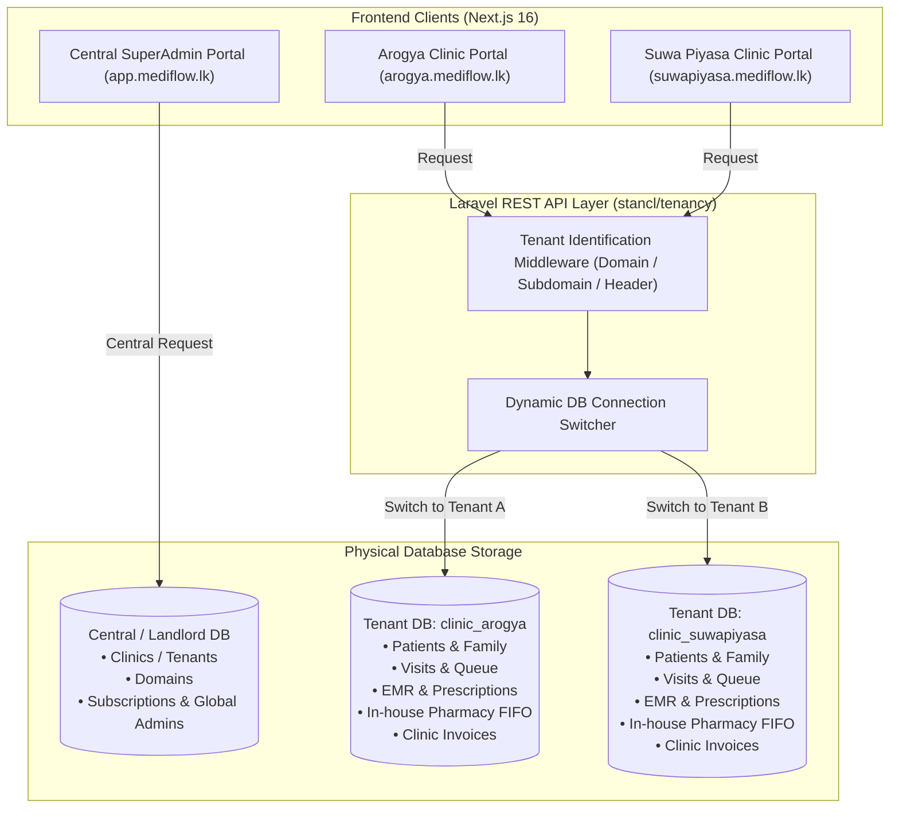
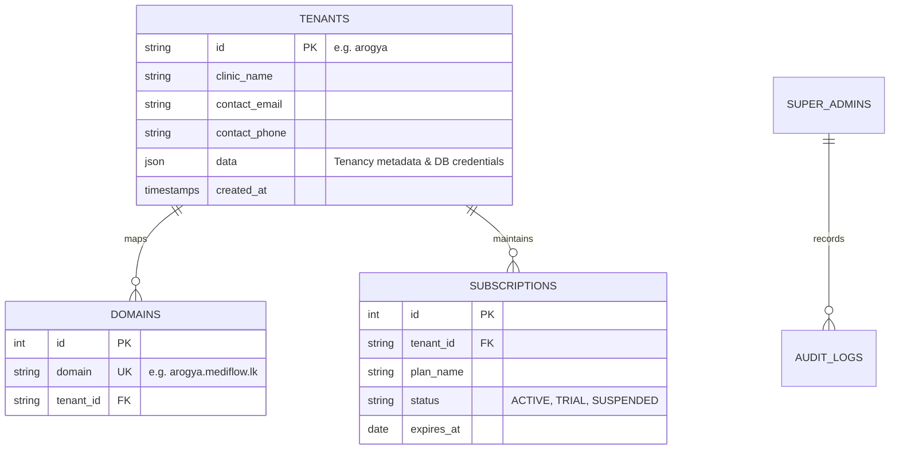
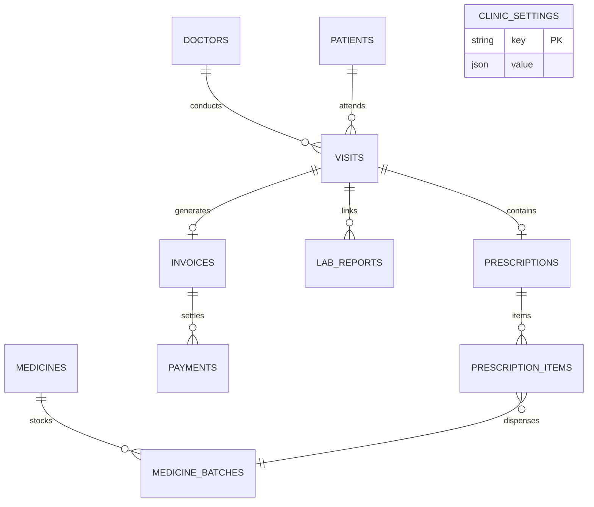
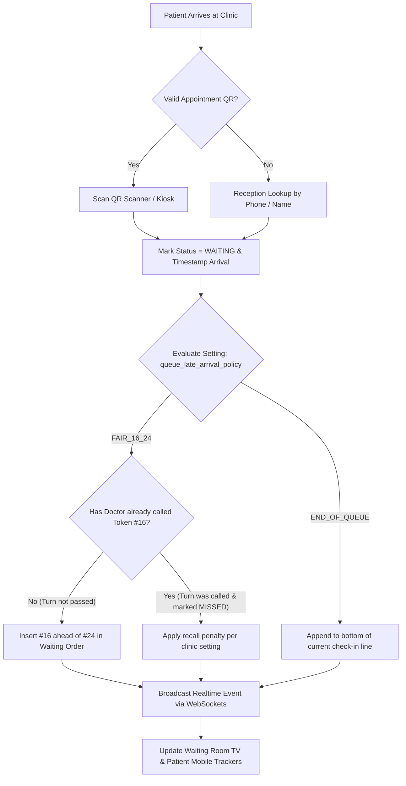
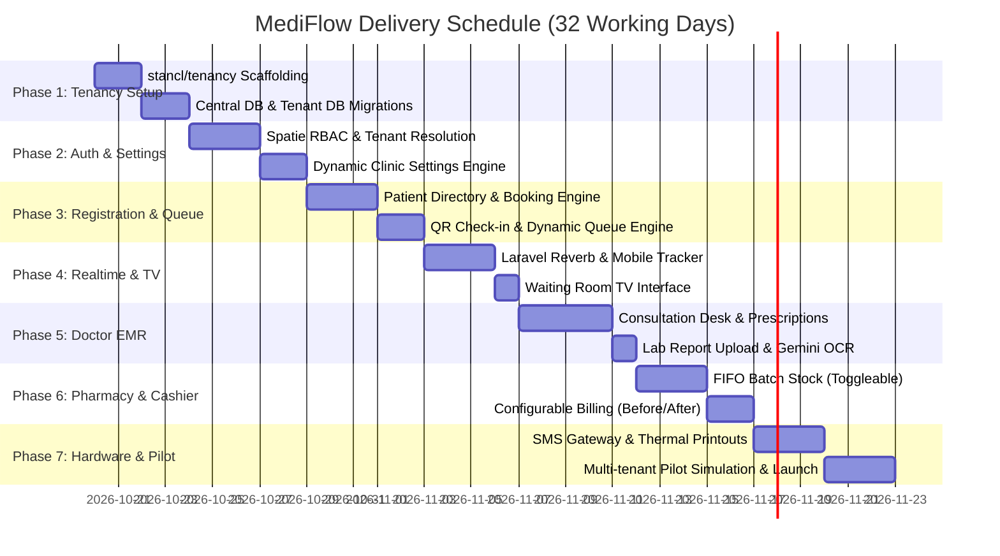

# MediFlow — Master Project Implementation Plan & Execution Blueprint
## Multi-Database SaaS Architecture Edition (`stancl/tenancy`)

- **Project:** MediFlow (Clinic and Patient Management System)
- **Deployment Model:** Multi-Database Software-as-a-Service (SaaS)
- **Author / Solution Provider:** TM Digital Solution ([tmgomis.online](https://tmgomis.online))
- **Date:** October 2026
- **Architecture Baseline:** Decoupled SaaS (Next.js 16 Frontend + Laravel Multi-Database REST API with `stancl/tenancy` + Isolated PostgreSQL/MySQL DBs + Reverb Realtime)
- **Companion Documents:**
  - [MediFlow Project Plan](file:///d:/tharindu/MediFlow/doc/MediFlow_Project_Plan.md)
  - [MediFlow Technical Architecture](file:///d:/tharindu/MediFlow/doc/MediFlow_Technical_Architecture.md)

---

## 1. Executive Summary & Multi-Database Architecture

MediFlow is engineered as a **Multi-Database SaaS Platform** tailored specifically for healthcare. Unlike shared single-database systems where data leakage can occur due to query bugs, MediFlow guarantees **100% physical data isolation** by provisioning an independent database for each medical practice.



### Core Advantages for Medical Clinics
1. **Absolute Medical Confidentiality:** A query in Clinic A's context cannot physically touch Clinic B's database. Zero possibility of SQL cross-contamination.
2. **Individual Clinic Backups & Restores:** Individual clinic databases can be backed up, restored, or exported without affecting any other clinic.
3. **Dedicated Portability (Clinic Offboarding):** If a hospital or large practice requires an on-premise or private cloud server later, their database can simply be exported and migrated intact.
4. **Clean Codebase:** Models and queries do not require `clinic_id` columns, global scopes, or composite foreign keys inside tenant databases.

---

## 2. Central (Landlord) DB vs Tenant DB Schema Design

The database schema is divided into two distinct migration groups:

### 2.1 Central (Landlord) Database Schema
Manages platform operations, tenant registration, and SaaS billing.



### 2.2 Isolated Tenant Database Schema (Per Clinic)
Every clinic receives its own database containing clinical, operational, and inventory data.



---

## 3. Dynamic Clinic Settings Engine (`clinic_settings`)

Inside each tenant's database, a `clinic_settings` table allows complete customization:

| Setting Key | Allowed Values | Default | Effect on Clinic Workflow |
|---|---|---|---|
| `consultation_payment_timing` | `'BEFORE'`, `'AFTER'` | `'AFTER'` | • `'BEFORE'`: Fee collected before queue token.<br>• `'AFTER'`: Billed at checkout with pharmacy. |
| `pharmacy_enabled` | `true`, `false` | `true` | • `true`: Enables FIFO batch stock & dispensing.<br>• `false`: External prescription slips only. |
| `queue_late_arrival_policy` | `'FAIR_16_24'`, `'END_OF_QUEUE'` | `'FAIR_16_24'` | Fair catch-up logic for checked-in patients. |
| `queue_missed_recall_penalty` | `'END_OF_WAITING'`, `'AFTER_3'` | `'END_OF_WAITING'` | Placement when a missed patient returns. |
| `sms_gateway_provider` | `'notify_lk'`, `'dialog'`, `'mobitel'`, `'mock'` | `'notify_lk'` | Active SMS dispatch driver. |
| `sms_sender_mask` | String (e.g. `'MEDIFLOW'`) | `'MEDIFLOW'` | Mobile SMS Sender ID. |
| `thermal_printer_width` | `'80mm'`, `'58mm'` | `'80mm'` | Thermal receipt and token slip formatting. |
| `clinic_branding` | JSON | `{}` | Logo, registration number, address, and prescription header. |

---

## 4. Live Queue Management Algorithm (The 16 vs 24 Rule)



---

## 5. Phased Implementation Roadmap (7-Phase Schedule)



### Phase Details

#### Phase 1: Environment Setup & Multi-Database Scaffolding (Days 1–4)
- Set up local Laragon development environment (PHP 8.3/8.4, Composer, MySQL/PostgreSQL).
- Install and configure `stancl/tenancy` inside Laravel.
- Configure Central Database connection (`landlord`) and dynamic Tenant Database connection (`tenant`).
- Create migration directories:
  - `database/migrations/` (Central DB: `tenants`, `domains`, `subscriptions`)
  - `database/migrations/tenant/` (Tenant DB: `users`, `patients`, `visits`, `prescriptions`, `medicines`, `batches`, `invoices`, `settings`)
- Build tenant creation pipeline (automated database provisioning).

#### Phase 2: Tenant Resolution, RBAC & Settings Engine (Days 5–7)
- Configure tenant resolution via Subdomain (e.g. `arogya.mediflow.lk`) and Header (`X-Tenant: arogya` for Next.js API calls).
- Integrate Spatie `laravel-permission` inside tenant databases for roles: `ClinicAdmin`, `Receptionist`, `Doctor`, `Pharmacist`, `Cashier`.
- Implement `ClinicSettingsService` to manage payment timing (`BEFORE`/`AFTER`), pharmacy module toggle, and SMS configs.
- Build Next.js Clinic Settings panel.

#### Phase 3: Patient Registration, Appointments & QR Check-in (Days 8–12)
- Patient directory with permanent ID generator (`MF-YYYY-XXXXX`).
- Duplicate detection algorithm per clinic.
- Session booking engine with capacity protection.
- QR scanner integration for fast check-in.

#### Phase 4: Live Queue Engine & Realtime Synchronization (Days 13–16)
- Implement `QueueManagerService` incorporating the 16 vs 24 priority sorting.
- Deploy Laravel Reverb WebSocket server with tenant-scoped channels (`tenant.{tenant_id}.queue`).
- Waiting Room TV view (`/tv`): Fullscreen real-time token board with sound chime.
- Patient Mobile Live Tracker (`/q/[token]`): Live waiting position and estimated arrival time.

#### Phase 5: Doctor Consultation Desk (EMR) & Lab Records (Days 17–21)
- Doctor interface: Patient Vitals, Allergy badges, and clinical notes.
- Prescription Engine: Drug auto-complete, dosage, frequency, duration, instructions.
- Lab Results uploader (PDF/JPG scans) linked to visit with statuses `Pending` ➔ `Received` ➔ `Reviewed`.
- Optional Google Gemini 1.5 Flash assistant for automatic OCR of lab values.

#### Phase 6: Pharmacy FIFO Inventory & Dual-Mode Billing (Days 22–26)
- **Conditional Pharmacy Module:**
  - If `pharmacy_enabled = true`: Batch catalogue, purchase cost, retail price, and FIFO earliest-expiry dispensing deduction.
  - If `pharmacy_enabled = false`: Bypasses inventory, outputs external prescription printout.
- **Configurable Billing Workflow:**
  - If `consultation_payment_timing = 'BEFORE'`: Reception/Cashier settles doctor fee prior to consultation.
  - If `consultation_payment_timing = 'AFTER'`: Cashier generates combined invoice at checkout.
- Cashier Day-End Reconciliation Report.

#### Phase 7: Hardware Integrations, SMS Drivers & Pilot Launch (Days 27–32)
- ESC/POS thermal printing (80mm/58mm) for tokens, prescriptions, and receipts.
- Multi-provider SMS Driver (Notify.lk, Dialog, Mobitel, and Mock driver for testing).
- Multi-tenant pilot simulation running 2 distinct mock clinics with opposing settings (one with Pay-Before + No Pharmacy; one with Pay-After + In-house Pharmacy).
- Production deployment on Hetzner Cloud VPS + Cloudflare SSL.

---

## 6. Directory Structure Blueprint

```
d:/tharindu/MediFlow/
├── backend/                  # Laravel Multi-Tenant API (PHP 8.3/8.4)
│   ├── app/
│   │   ├── Http/Controllers/Api/   # Tenant-aware Controllers
│   │   ├── Models/Tenant/          # Tenant Models (Patient, Visit, Prescription, etc.)
│   │   ├── Models/Central/         # Central Models (Tenant, Domain, Subscription)
│   │   ├── Services/               # ClinicSettingsService, QueueEngine, FifoStockService
│   │   └── Events/                 # Realtime Queue Events (scoped to tenant channel)
│   ├── database/
│   │   ├── migrations/             # Central DB Migrations
│   │   ├── migrations/tenant/      # Tenant DB Migrations (auto-migrated per tenant DB)
│   │   └── seeders/                # Central & Tenant Seeders
│   └── routes/
│       ├── api.php                 # Tenant API Routes (wrapped in stancl/tenancy middleware)
│       └── central.php             # SuperAdmin Landlord Routes
├── frontend/                 # Next.js 16 (App Router) + React 19 + Tailwind v4
│   ├── src/
│   │   ├── app/
│   │   │   ├── (auth)/             # Staff Login
│   │   │   ├── (dashboard)/        # Role-based Portal (Reception, Doctor, Pharmacy, Cashier)
│   │   │   ├── tv/                 # Fullscreen Waiting Room TV Realtime Display
│   │   │   └── q/[token]/          # Patient Mobile Live Queue Tracker
│   │   ├── contexts/               # ClinicConfigContext (supplies active tenant settings)
│   │   └── lib/                    # API Client with automatic Tenant Header injection
└── doc/                      # Project Specifications & Documentation
```

---

## 7. Cost & Infrastructure Summary

| Component | Provider / Tier | Monthly Cost (USD) | Monthly Cost (LKR) |
|---|---|---|---|
| **Web & API Server** | Hetzner Cloud VPS (CX22, 2 vCPU, 4GB RAM) | $4.10 | ~LKR 1,250 |
| **Database & Backups** | MySQL 8 / PostgreSQL 16 on VPS + Daily R2 Offsite Backup | Included | Included |
| **WebSockets (Realtime)** | Laravel Reverb (Runs on VPS) | Included | Included |
| **Frontend CDN & SSL** | Cloudflare / Vercel Edge Free Tier | $0.00 | LKR 0 |
| **AI Lab OCR / Copilot** | Google Gemini Flash (Google AI Studio Free Tier) | $0.00 | LKR 0 |
| **Clinic Domain Name** | Wildcard SSL on `.lk` or `.com` Domain (`*.mediflow.lk`) | ~$1.00 | ~LKR 300 |
| **SMS Gateway** | Notify.lk / Local Gateway (~3,000 SMS / month) | ~$8.00 | ~LKR 2,500 |
| **Total Base Infrastructure Cost** | *(Excluding variable SMS messages)* | **~$5.10 / mo** | **~LKR 1,550 / mo** |
