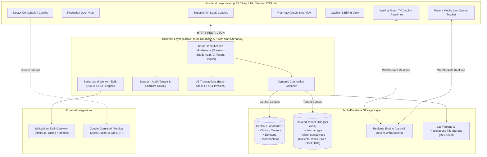
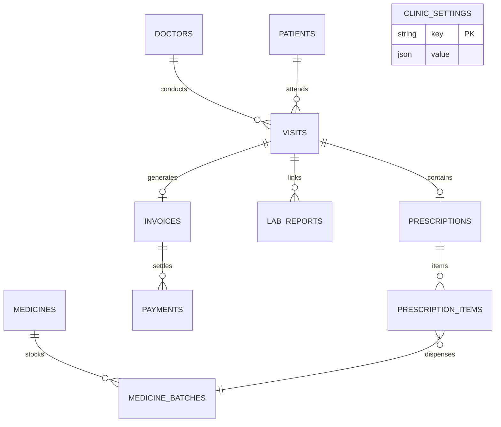

# MediFlow — Technical Architecture & Deployment Specification
## Multi-Database SaaS Architecture Edition

- **System Name:** MediFlow (Clinic & Patient Management System)
- **Document Type:** Technical Architecture, Database Specification & Infrastructure Planning
- **Author:** TM Digital Solution
- **Version:** 2.0 (Multi-Database SaaS Architecture)
- **Companion Document:** [MediFlow Master Implementation Plan](file:///d:/tharindu/MediFlow/doc/MediFlow_Master_Implementation_Plan.md)

---

## 1. Architecture Overview

MediFlow is engineered as a **Decoupled Multi-Database SaaS Application** designed for high security, zero cross-tenant contamination, and rapid execution in Sri Lankan outpatient clinics.

---

## 2. Technology Stack Selection

### 2.1 Frontend (User Interfaces)
* **Framework:** Next.js 16 (App Router) + React 19.
* **Styling & Design System:** Tailwind CSS v4, Clinical Teal theme (`#0F766E`), Lucide React icons.
* **State & Query Management:** React Context API + SWR / TanStack Query for client-side caching.
* **Tenant Injection:** Auto-injects `X-Tenant` header or utilizes tenant subdomain routing (`clinic.mediflow.lk`).
* **Hardware Compatibility:** Thermal receipt printing (ESC/POS 80mm/58mm), 2D barcode & QR scanner support, optimized for low-spec clinic reception desktops.

### 2.2 Backend Layer (Laravel Multi-Database API)
* **Framework:** Laravel (PHP 8.3/8.4) with `stancl/tenancy` multi-database package.
* **Tenancy Engine:** Automatic tenant database creation upon clinic registration. Dynamic runtime switching of MySQL/PostgreSQL connection.
* **Authentication & RBAC:** Laravel Sanctum with Spatie `laravel-permission` (Doctor, Receptionist, Pharmacist, Cashier, ClinicAdmin).
* **Database Transactions:** Atomic `DB::transaction` with `lockForUpdate()` ensuring FIFO medicine batch deduction and invoice consistency.
* **Realtime Server:** Laravel Reverb (zero-dependency WebSocket server) with tenant-scoped private channels (`tenant.{id}.queue`).

---

## 3. Database Schema: Central vs Tenant Isolation

### 3.1 Central (Landlord) Database Schema
Stores global platform management entities:
- `tenants`: Clinic identifier, clinic name, contact details, database credentials JSON.
- `domains`: Subdomains and custom domains mapped to tenant IDs (e.g., `arogya.mediflow.lk`).
- `subscriptions`: Plan tier, trial dates, status (`ACTIVE`, `SUSPENDED`).
- `super_admins`: Platform administrator credentials and global audit logs.

### 3.2 Tenant Database Schema (Isolated per Clinic)
Every clinic has a dedicated physical database with zero `clinic_id` pollution:

---

## 4. Live Queue Management Algorithm (16 vs 24 Rule)

To prevent queue skipping and handle late arrivals fairly:
1. **Queue Position vs Token Number:** A patient's permanent token (e.g. #16) is distinct from their real-time waiting position.
2. **Late Check-in:** If Token 24 checks in first at 05:00 PM, and Token 16 checks in at 05:10 PM *before Token 16's turn has passed*, Token 16 automatically assumes the earlier waiting position ahead of 24.
3. **In-Consultation Lock:** If Token 24 is already inside the consultation room (`IN_CONSULTATION`), Token 16's arrival does not interrupt the consultation.
4. **Missed Turns:** If a patient is marked `MISSED`, their turn resets to the bottom of the currently checked-in waiting group.
5. **Clinical Urgency (Emergency):** Authorized reception/nursing staff can apply an emergency priority override with a mandatory recorded reason.

---

## 5. AI Copilot Architecture (Google Gemini Integration)

* **Model:** Google Gemini 1.5 Flash / 2.0 Flash (Fast & Free Tier eligible) or Gemini 4 Argon for complex reasoning.
* **Doctor Consultation Copilot:**
  * Analyzes patient chronic conditions and past visits to suggest relevant quick diagnoses and prescription presets.
  * Drug-allergy interaction alert (e.g., flags Penicillin prescription if patient profile has a penicillin allergy).
* **Lab Report OCR Agent:**
  * Extracts test parameters (e.g., FBC, Lipid Profile, Blood Sugar) from uploaded JPG/PDF lab scans into structured tabular data.
* **Cost Structure:**
  * Google AI Studio Free Tier provides 1,500 requests/day at **$0 (100% Free)** during development and initial clinic operation.
  * Pay-as-you-go production cost: Under **$1.00 / month** (under LKR 300).

---

## 6. Hosting & Deployment Infrastructure Plan (Monthly Pricing)

Designed to deliver enterprise reliability at the lowest possible recurring operational cost for Sri Lankan clinics:

### Production Architecture
| Component | Hosting Provider | Specifications | Monthly Cost |
|---|---|---|---|
| **Frontend Application** | Cloudflare Pages or Vercel | Next.js Edge / CDN, Global SSL, Auto Deploy | **$0.00 (Free)** |
| **Backend & Database VPS** | Hetzner Cloud (CX22) / DigitalOcean | 2 vCPU, 4GB RAM, 40GB NVMe SSD, Ubuntu Linux | **€3.79 (~$4.10 / LKR 1,250)** |
| **Database Engine** | MySQL 8 / PostgreSQL 16 on VPS | Separate DB per clinic, Daily Automated Backups to R2 | **$0.00 (Included in VPS)** |
| **Realtime WebSockets** | Laravel Reverb (on VPS) | Low-latency WebSockets for Waiting Room TV | **$0.00 (Included in VPS)** |
| **File Storage (Reports)** | Local VPS Storage / Cloudflare R2 | Encrypted PDF/JPG storage with zero egress fees | **$0.00 (Under 10GB free)** |
| **Domain Name** | Local Registrar / Cloudflare | Custom wildcard domain (`*.mediflow.lk`) | **~$1.00 / mo (~LKR 300)** |
| **SMS Gateway** | Notify.lk / Dialog / Mobitel | ~3,500 SMS/mo for bookings & live queue alerts | **~LKR 2,500 / mo (~$8.00)** |
| **Total Base Server Hosting Cost** | | | **~$5.00 / month (~LKR 1,500/mo)** |
